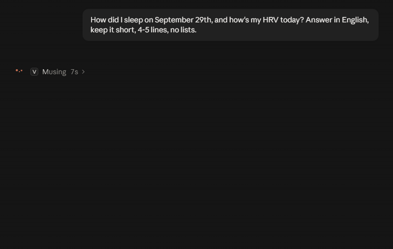
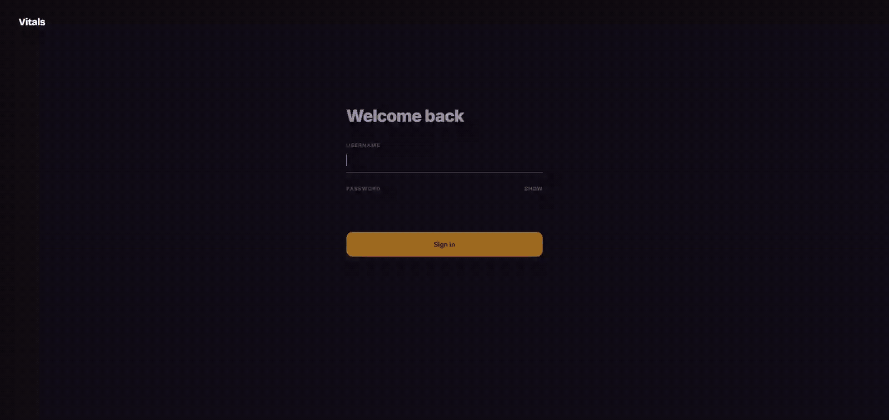
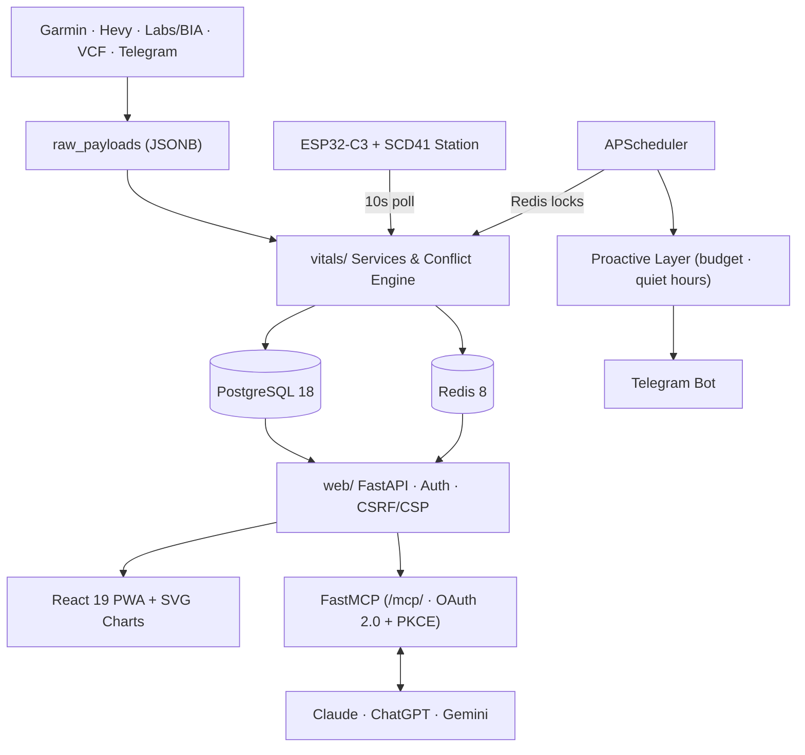
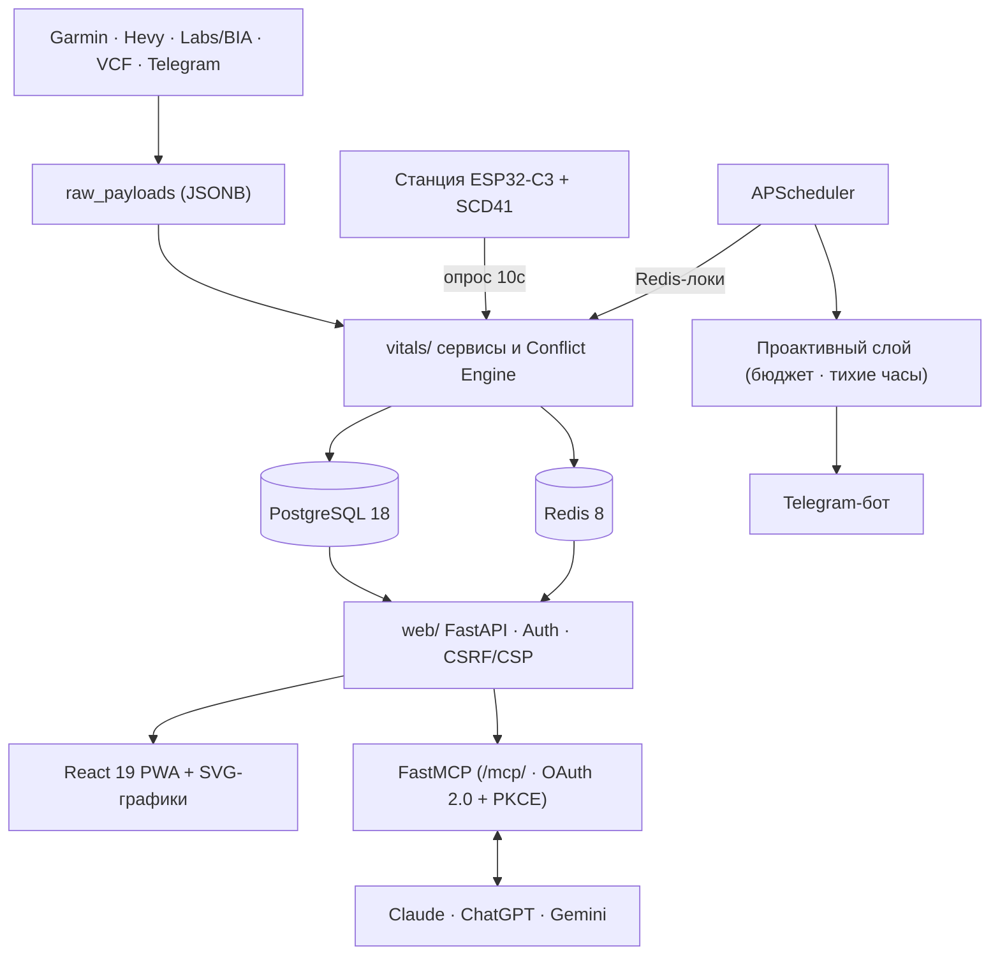

<p align="center">
  
</p>

<h1 align="center">Vitals</h1>

<p align="center">
  Self-hosted personal health data lake &amp; dashboard with 104 MCP tools<br>
  <sub>React PWA (EN/RU) · 15 domains · Elastic License 2.0</sub>
</p>

<p align="center">
  
</p>

<p align="center">
  <a href="#lang-en">English</a> &nbsp;·&nbsp; <a href="#lang-ru">Русский</a>
</p>

---

<a id="lang-en"></a>

## Vitals

A single-user health dashboard and PostgreSQL data lake. Collects weight and body composition, Garmin sleep and recovery, Hevy workouts, nutrition, GLP-1 therapy, HRT/TRT cycles, bloodwork, genetics, supplements, skincare, free-text Telegram notes, and bedroom air quality in one place.

I built it after my data ended up split across five separate apps and spreadsheets: none of them linked sleep to workout recovery or lab markers to a supplement stack. Written with Claude; the data model, domain boundaries, and rule catalog are mine.

<p align="center">
  
</p>

https://github.com/user-attachments/assets/171de17f-538b-4395-a9b6-656670380811

### Design Choices

- Inbound payloads from Garmin, Hevy, lab PDFs/photos, InBody/MedAss BIA sheets, VCF files, and Telegram messages are stored raw in JSONB (`raw_payloads`) alongside normalized rows. A nightly job at 03:30 re-parses flagged history without re-uploading when a parser changes.
- [conflict_rules.yaml](vitals/data/conflict_rules.yaml) holds 134 sourced rules with evidence tiers covering nutrient absorption, pharmacogenomics, lab safety, GLP-1, HRT, and skincare actives, backed by 217 GRCh38-verified SNPs in [genetics_snps.yaml](vitals/data/genetics_snps.yaml). A hard conflict returns `409 Conflict` and saves only through an explicit, logged override.
- Built for one owner and bound to `127.0.0.1:8000` by default. Auth uses bcrypt passwords, signed session cookies, optional TOTP 2FA, and passkeys; fonts are served locally under a strict CSP with zero external CDNs.
- Any module can be switched off in `/settings`, removing it from navigation and MCP. `/share` generates an immutable, password-protected snapshot link or a standalone offline HTML report with no scripts.

### 15 Domains

| Area | Routes | What's inside |
| :--- | :--- | :--- |
| Weight & BIA | `/weight` | 7-day moving average, noise-period exclusions, goal-date projection, Navy body-fat formula, progress photos, and LLM vision parsing for InBody / MedAss BIA sheets. Manual entries and BIA scans override Garmin. |
| Recovery & Gym | `/recovery`, `/workouts`, `/nutrition` | Garmin auto-sync (sleep stages, HRV, resting HR, stress, Body Battery), Hevy strength workouts, and macro tracking against targets. Optional conservative weight export back to Garmin writes only to empty days. |
| Therapy | `/glp1`, `/hrt` | GLP-1 injection log with body-map rotation and plateau detection (<100 g/week for >14 days). HRT/TRT tracking with 73 compounds in [hrt_compounds.yaml](vitals/data/hrt_compounds.yaml), ml → mg conversion, cycle templates, and active-release curves. Logging only — no dosage advice. |
| Labs & Care | `/labs`, `/genetics`, `/supplements`, `/skincare`, `/interactions` | OCR lab parsing via OpenRouter, VCF import (up to 50k lines), supplement catalog with EN/RU synonym matching, AM/PM skincare routine with face photo diary, and conflict-rule toggles. |
| Bot & Air | `/signals`, `/environment` | Free-text Telegram messages ("coffee at 22:00", "headache") parse into events for AI briefs. Morning brief, evening check-in, and budgeted nudges. Plus optional polling of a bedroom ESP32-C3 + SCD41 CO₂/temp/humidity station ([firmware](firmware/environment-station/README.md)). |
| Analytics | `/timeline`, `/charts`, `/reports` | Event overlays on charts, custom multi-metric chart builder, and weekly AI digests. |

### MCP Server (104 Tools)

Built-in FastMCP server at `/mcp/` (streamable HTTP) with OAuth 2.0, mandatory PKCE (`S256`), and RFC 9728 metadata. To connect Claude.ai, ChatGPT, or Gemini as a custom connector, point the client to `https://<your-host>/mcp/` with `VITALS_MCP_CLIENT_ID` and `VITALS_MCP_CLIENT_SECRET` from `.env` (allowed callback hosts live in `VITALS_MCP_REDIRECT_HOSTS`, defaulting to `claude.ai`, `chatgpt.com`, and `oauth-redirect.googleusercontent.com`). Optionally, `VITALS_MCP_AGENT_TOKEN` (32+ characters) lets an MCP client that cannot run the OAuth flow, such as a local agent on the same host, connect with `Authorization: Bearer <token>`; it works for `/mcp/` only.

Exposes reads, writes, conflict overrides, photo inspection, charts, doctor shares, and rate-limited `sync_garmin` / `sync_hevy` (3/day), plus 2 resources (`vitals://profile`, `vitals://digest/latest`) and the `weekly_review` prompt. Disabled modules are omitted from `tools/list`, and responses strip `null` and internal columns to save context tokens. Full surface in [web/routers/mcp.py](web/routers/mcp.py).

### Architecture & Stack



- Backend: Python 3.14, FastAPI, async SQLAlchemy 2, PostgreSQL 18, Redis 8, APScheduler, OpenRouter.
- Frontend: React 19, TypeScript, TanStack Router & Query, Vite PWA, custom SVG charts; design tokens in [docs/DESIGN_SYSTEM.md](docs/DESIGN_SYSTEM.md).
- `vitals/` holds domain models and services with zero `web/` imports, tested independently of HTTP.

### Quick Start (Docker Compose)

1. Clone the repository and copy the environment template:
   ```bash
   git clone https://github.com/ilodezis/vitals.git
   cd vitals
   cp .env.example .env
   ```
2. Generate a session secret and a bcrypt password hash:
   ```bash
   python -c "import secrets; print(secrets.token_urlsafe(48))"
   python -c "import bcrypt; print(bcrypt.hashpw(b'your-password', bcrypt.gensalt(4)).decode())"
   ```
3. Set `VITALS_SESSION_SECRET`, `VITALS_AUTH_USERNAME`, `VITALS_AUTH_PASSWORD_HASH`, `VITALS_DB_PASSWORD`, and `VITALS_MCP_CLIENT_SECRET` in `.env`. All optional integrations (OpenRouter, Garmin, Hevy, Telegram, `VITALS_PUBLIC_ORIGIN` for passkeys, environment station) are documented in [.env.example](.env.example).
4. Start the stack:
   ```bash
   docker compose up -d --build
   curl -s http://127.0.0.1:8000/health
   ```
   Alembic migrations run on startup. Expose the app over a VPN (Tailscale/WireGuard), Cloudflare Tunnel + Access, or a TLS reverse proxy; enable TOTP 2FA and passkeys in `/settings` if reachable over HTTPS.

### Local Development & Tests

```bash
python -m venv .venv
source .venv/bin/activate       # Windows: .venv\Scripts\activate
pip install -r requirements-dev.txt
npm --prefix frontend ci

npm --prefix frontend run build
python scripts/seed_demo.py     # optional: idempotent demo dataset
python run_local.py             # SQLite + FakeRedis, login: timur / password
```

```bash
python -m pytest -q             # unit suite on SQLite
bash scripts/test_postgres.sh   # Postgres integration tests (Docker)
npm --prefix frontend run check # typecheck, vitest, build, bundle budget
```

Run `npm --prefix frontend run gen` after changing backend endpoints. See [CONTRIBUTING.md](CONTRIBUTING.md) for guidelines.

### Support & License

* **Russian Cards (CloudTips)**: [pay.cloudtips.ru/p/5bb82648](https://pay.cloudtips.ru/p/5bb82648)
* **International Cards (Ko-fi)**: [ko-fi.com/ilodezis](https://ko-fi.com/ilodezis)
* **USDT (TRC-20)**: `TV6bMburcEjgkinkZBvt9DonkyiaP7TqHG`
* **USDT (Arbitrum One)**: `0x3eac15f5d07bba100d4038cad603e420a84753bb`

Licensed under **Elastic License 2.0** — free to use, modify, and distribute, including for internal business use; offering the software to third parties as a hosted or managed service (SaaS) is prohibited. See [LICENSE](LICENSE) and [NOTICE](NOTICE).

---

<a id="lang-ru"></a>

## Vitals

Однопользовательский дашборд здоровья и хранилище данных на PostgreSQL. Собирает в одном месте вес и состав тела, сон и восстановление Garmin, тренировки Hevy, питание, протокол GLP-1, курсы ГЗТ/TRT, анализы, генетику, добавки, уход за кожей, свободные заметки из Telegram и воздух в спальне.

Я завёл его, когда данные разъехались по пяти разным приложениям и таблицам: ни одно не связывало сон с восстановлением после тренировки или анализы со схемой добавок. Код написан вместе с Claude; модель данных, границы доменов и правила — мои.

### Как устроен

- Исходные ответы Garmin, Hevy, PDF/фото анализов, бланки InBody и МедАсс, VCF и сообщения Telegram сначала сохраняются в JSONB-таблицу `raw_payloads`. Ночной джоб в 03:30 может перепарсить историю без повторной загрузки, если парсер обновился.
- В [conflict_rules.yaml](vitals/data/conflict_rules.yaml) описано 134 правила с источниками и уровнем доказательности: усвоение добавок, фармакогенетика, безопасность анализов, GLP-1, ГЗТ и совместимость активов для кожи — с опорой на 217 верифицированных по GRCh38 SNP в [genetics_snps.yaml](vitals/data/genetics_snps.yaml). Жёсткий конфликт отдаёт `409` и пропускает запись только после явного override с записью причины.
- Приложение рассчитано на одного владельца и слушает только `127.0.0.1:8000`. Вход защищён bcrypt-паролем, подписанными куками, опциональным TOTP и passkeys; шрифты лежат локально, CSP запрещает внешние CDN.
- Любой модуль отключается в `/settings` (пропадает из навигации и MCP). В `/share` можно собрать замороженный снимок отчёта для врача по временной ссылке с паролем или скачать его автономным офлайн-HTML без скриптов.

### 15 доменов

| Область | Экраны | Что внутри |
| :--- | :--- | :--- |
| Вес и BIA | `/weight` | 7-дневное скользящее среднее, исключение шумовых периодов, прогноз цели, формула Navy, фото прогресса, vision-разбор сканов InBody / МедАсс. Ручной ввод и BIA перекрывают Garmin. |
| Сон и зал | `/recovery`, `/workouts`, `/nutrition` | Автосинк Garmin (фазы сна, HRV, пульс покоя, стресс, Body Battery) и Hevy; питание и цели по КБЖУ. Опциональная выгрузка свежего веса обратно в Garmin только в пустой день. |
| Терапия | `/glp1`, `/hrt` | Лог GLP-1 с картой мест инъекций и детекцией плато (<100 г/нед на дозе дольше 14 дней). ГЗТ/TRT: 73 препарата в [hrt_compounds.yaml](vitals/data/hrt_compounds.yaml), мл → мг, шаблоны курсов и кривая активного релиза. Только учёт, без советов по дозам. |
| Анализы и уход | `/labs`, `/genetics`, `/supplements`, `/skincare`, `/interactions` | OCR анализов через OpenRouter, импорт VCF (до 50k строк), каталог добавок с RU/EN-синонимами, утренний/вечерний уход с фотодневником и переключатели правил конфликтов. |
| Бот и воздух | `/signals`, `/environment` | Свободный текст в Telegram («кофе в 22», «голова болит») разбирается в события для AI. Утренний бриф, вечерний опрос, редкие нуджи по бюджету. Плюс опрос домашней станции CO₂/t°/влажности на ESP32-C3 + SCD41 ([прошивка](firmware/environment-station/README.md)). |
| Аналитика | `/timeline`, `/charts`, `/reports` | Флажки событий на графиках, конструктор наложения любых метрик и еженедельные AI-дайджесты. |

### MCP-сервер (104 инструмента)

Встроенный FastMCP на `/mcp/` (streamable HTTP) с OAuth 2.0, обязательным PKCE (`S256`) и RFC 9728. Чтобы подключить Claude.ai, ChatGPT или Gemini, укажите в настройках коннектора адрес `https://<ваш-хост>/mcp/` и пару `VITALS_MCP_CLIENT_ID` / `VITALS_MCP_CLIENT_SECRET` из `.env` (разрешённые хосты обратного вызова задаются в `VITALS_MCP_REDIRECT_HOSTS`, по умолчанию — `claude.ai`, `chatgpt.com`, `oauth-redirect.googleusercontent.com`). Необязательная переменная `VITALS_MCP_AGENT_TOKEN` (32+ символа) нужна MCP-клиентам, которые не умеют проходить OAuth, например локальному агенту на том же хосте: он подключается с `Authorization: Bearer <токен>`; токен действует только на `/mcp/`.

Через MCP доступны чтение, запись, override конфликтов, просмотр фото, графики, отчёты для врача и лимитированная синхронизация (`sync_garmin` / `sync_hevy`, 3 вызова в сутки), а также 2 ресурса (`vitals://profile`, `vitals://digest/latest`) и промпт `weekly_review`. Выключенные модули скрываются из `tools/list`, а ответы вырезают `null` и служебные поля, чтобы не тратить контекст. Весь список — в [web/routers/mcp.py](web/routers/mcp.py).

### Стек и архитектура



- Backend: Python 3.14, FastAPI, async SQLAlchemy 2, PostgreSQL 18, Redis 8, APScheduler, OpenRouter.
- Frontend: React 19, TypeScript, TanStack Router & Query, Vite PWA, SVG-графики; дизайн-система в [docs/DESIGN_SYSTEM.md](docs/DESIGN_SYSTEM.md).
- Ядро `vitals/` не импортирует `web/` и тестируется отдельно от HTTP-слоя.

### Быстрый старт (Docker Compose)

1. Склонируйте репозиторий и скопируйте шаблон окружения:
   ```bash
   git clone https://github.com/ilodezis/vitals.git
   cd vitals
   cp .env.example .env
   ```
2. Сгенерируйте ключ сессий и bcrypt-хеш пароля:
   ```bash
   python -c "import secrets; print(secrets.token_urlsafe(48))"
   python -c "import bcrypt; print(bcrypt.hashpw(b'your-password', bcrypt.gensalt(4)).decode())"
   ```
3. Задайте в `.env` минимум `VITALS_SESSION_SECRET`, `VITALS_AUTH_USERNAME`, `VITALS_AUTH_PASSWORD_HASH`, `VITALS_DB_PASSWORD` и `VITALS_MCP_CLIENT_SECRET`. Все остальные переменные (OpenRouter, Garmin, Hevy, Telegram, `VITALS_PUBLIC_ORIGIN` для passkeys, станция воздуха) описаны в [.env.example](.env.example).
4. Запустите контейнеры:
   ```bash
   docker compose up -d --build
   curl -s http://127.0.0.1:8000/health
   ```
   Миграции Alembic накатываются при старте. Публикуйте инстанс через VPN (Tailscale/WireGuard), Cloudflare Tunnel + Access или обратный прокси с TLS; при публичном входе включите TOTP 2FA и passkeys в `/settings`.

### Локальная разработка и тесты

```bash
python -m venv .venv
source .venv/bin/activate       # Windows: .venv\Scripts\activate
pip install -r requirements-dev.txt
npm --prefix frontend ci

npm --prefix frontend run build
python scripts/seed_demo.py     # опционально: демо-данные (идемпотентно)
python run_local.py             # SQLite + FakeRedis, логин timur / password
```

```bash
python -m pytest -q             # юнит-тесты на SQLite
bash scripts/test_postgres.sh   # интеграционные на Postgres (нужен Docker)
npm --prefix frontend run check # типы, vitest, сборка и бюджет бандла
```

После правок API перегенерируйте клиент: `npm --prefix frontend run gen`. Детали — в [CONTRIBUTING.md](CONTRIBUTING.md).

### Поддержка и лицензия

* **Карты РФ (CloudTips)**: [pay.cloudtips.ru/p/5bb82648](https://pay.cloudtips.ru/p/5bb82648)
* **Международные карты (Ko-fi)**: [ko-fi.com/ilodezis](https://ko-fi.com/ilodezis)
* **USDT (TRC-20)**: `TV6bMburcEjgkinkZBvt9DonkyiaP7TqHG`
* **USDT (Arbitrum One)**: `0x3eac15f5d07bba100d4038cad603e420a84753bb`

Лицензия — **Elastic License 2.0**: свободное использование, модификация и распространение, в том числе внутри организаций; предоставление третьим лицам как hosted/managed-сервиса (SaaS) запрещено. См. [LICENSE](LICENSE) и [NOTICE](NOTICE).
